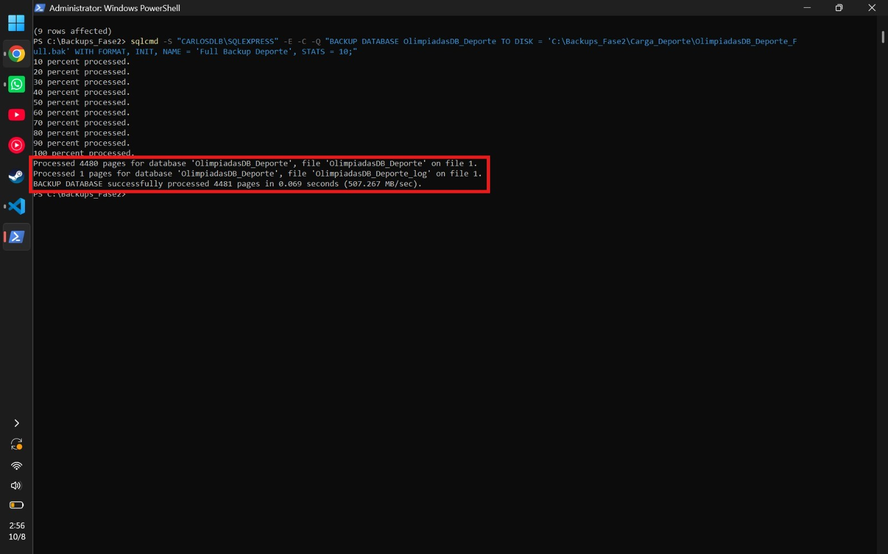
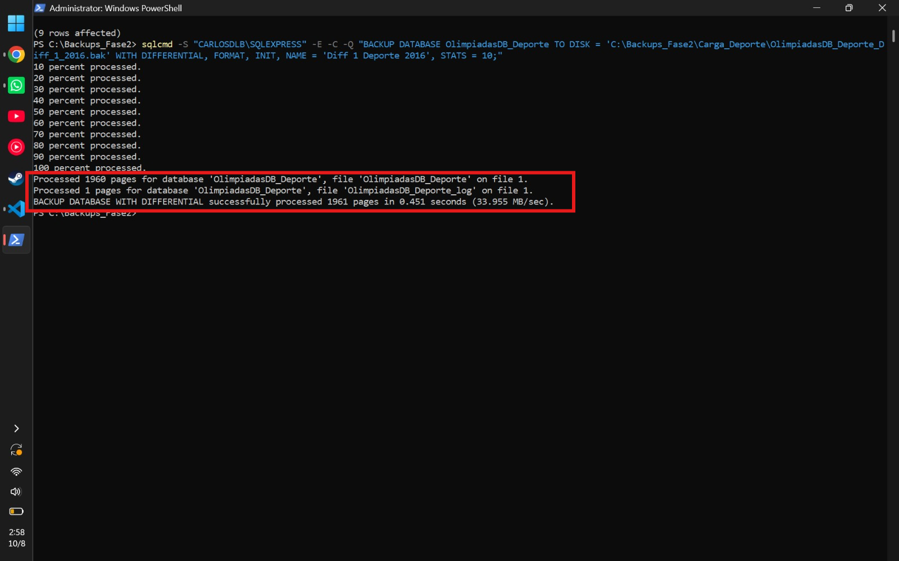
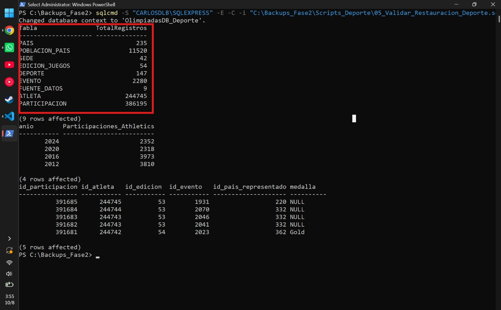
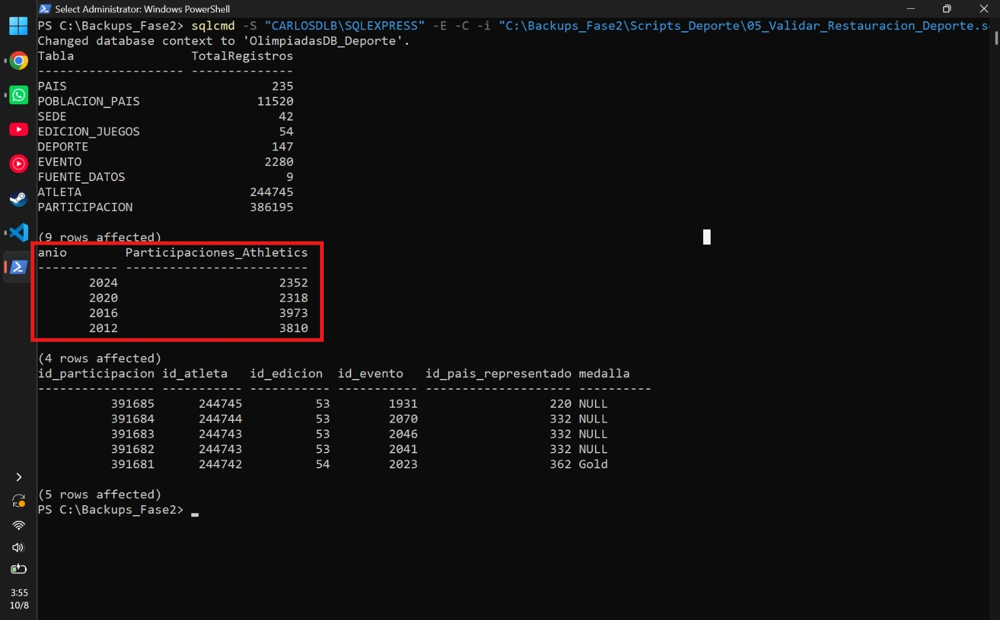
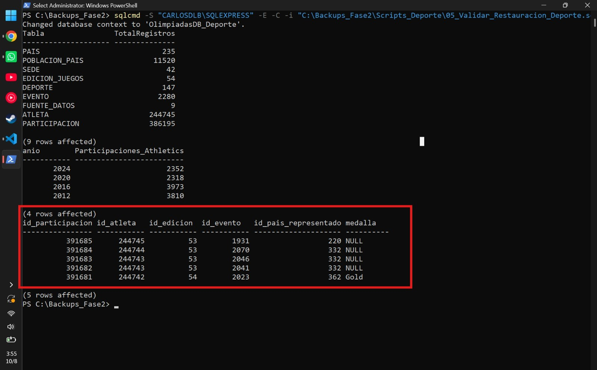

# Manual de Usuario: Respaldo y Restauración en Consola (SQL Server)

## 1. Introducción y Conexión al Servidor

Este manual detalla los procedimientos estandarizados para generar y restaurar copias de seguridad físicas (Backups) en Microsoft SQL Server utilizando exclusivamente la interfaz de línea de comandos (`sqlcmd`).

Para iniciar cualquier operación, el administrador debe conectarse a la instancia del servidor desde PowerShell o CMD utilizando autenticación de Windows (`-E`) y confiando en el certificado del servidor (`-C`):

```powershell
sqlcmd -S "CARLOSDLB\SQLEXPRESS" -E -C
```

## 2. Generación de Copias de Seguridad (Backups)

La estrategia de prevención ante desastres implementada combina un **Respaldo Completo (Full Backup)** como línea base, seguido de **Respaldos Diferenciales** periódicos que guardan únicamente los cambios ocurridos desde esa línea base.

### 2.1 Ejecución de un Respaldo Completo (Full Backup)

El Respaldo Completo copia la totalidad de las páginas de datos de la base de datos, creando el punto de restauración inicial (baseline).

**Comando de ejecución:**

```powershell
sqlcmd -S "CARLOSDLB\SQLEXPRESS" -E -C -Q "BACKUP DATABASE OlimpiadasDB_Deporte TO DISK = 'C:\Backups_Fase2\Carga_Deporte\OlimpiadasDB_Deporte_Full.bak' WITH FORMAT, INIT, NAME = 'Full Backup Deporte', STATS = 10;"
```

**Parámetros clave:** `FORMAT`, `INIT` sobrescriben cualquier medio anterior para garantizar un archivo limpio, y `STATS = 10` muestra el progreso en la consola cada 10%.

**Interpretación de Logs de Consola:**
Al finalizar, la consola emitirá un mensaje confirmando las páginas procesadas.



**¿Qué significa?** El log indica que el motor SQL procesó exitosamente 4,481 páginas de datos en 0.069 segundos. Esto confirma que toda la información de la base de datos ha sido empaquetada.

### 2.2 Ejecución de un Respaldo Diferencial

El Respaldo Diferencial es más rápido y ligero, ya que solo guarda las extensiones de datos que han sido modificadas desde el último Full Backup.

**Comando de ejecución:**

```powershell
sqlcmd -S "CARLOSDLB\SQLEXPRESS" -E -C -Q "BACKUP DATABASE OlimpiadasDB_Deporte TO DISK = 'C:\Backups_Fase2\Carga_Deporte\OlimpiadasDB_Deporte_Diff_1_2016.bak' WITH DIFFERENTIAL, FORMAT, INIT, NAME = 'Diff 1 Deporte 2016', STATS = 10;"
```

**Parámetro clave:** La instrucción `WITH DIFFERENTIAL` le indica al motor que únicamente lea el mapa de bits de cambios (DCM).

**Interpretación de Logs de Consola:**



**¿Qué significa?** A diferencia del Full Backup (que procesó 4,481 páginas), el log del Diferencial muestra que solo procesó 1,961 páginas. Esto demuestra su eficiencia, ya que ignora los datos históricos que no han cambiado y solo empaqueta las nuevas filas insertadas.

## 3. Procedimientos de Restauración (Disaster Recovery)

En caso de corrupción o pérdida total de datos, se debe recrear la base de datos utilizando los archivos `.bak` generados. Todo proceso de restauración exige primero poner la base de datos en modo de usuario único para expulsar conexiones activas, y luego eliminarla (`DROP DATABASE`).

### 3.1 Restauración Únicamente al Estado Inicial (Full Backup)

Si se desea regresar al punto exacto donde se tomó el respaldo completo inicial:

**Comando de ejecución:**

```powershell
sqlcmd -S "CARLOSDLB\SQLEXPRESS" -E -C -Q "RESTORE DATABASE OlimpiadasDB_Deporte FROM DISK = 'C:\Backups_Fase2\Carga_Deporte\OlimpiadasDB_Deporte_Full.bak' WITH RECOVERY, STATS = 10;"
```

**Parámetro clave:** `WITH RECOVERY` le indica a SQL Server que el proceso ha finalizado y que la base de datos ya puede abrirse para los usuarios.

### 3.2 Restauración a un Punto Específico en el Tiempo (Full + Diferencial)

Dado que los respaldos diferenciales son acumulativos respecto a la base, para recuperar el sistema a un momento avanzado solo se necesitan dos pasos:

1. Restaurar el Full Backup dejándolo en estado de espera (`NORECOVERY`).
2. Restaurar el último Backup Diferencial necesario cerrando el ciclo (`RECOVERY`).

**Comandos de ejecución (Ejemplo restaurando hasta el Diferencial 3):**

```powershell
sqlcmd -S "CARLOSDLB\SQLEXPRESS" -E -C -Q "RESTORE DATABASE OlimpiadasDB_Deporte FROM DISK = 'C:\Backups_Fase2\Carga_Deporte\OlimpiadasDB_Deporte_Full.bak' WITH NORECOVERY; RESTORE DATABASE OlimpiadasDB_Deporte FROM DISK = 'C:\Backups_Fase2\Carga_Deporte\OlimpiadasDB_Deporte_Diff_3_2024.bak' WITH RECOVERY, STATS = 10;"
```

**Parámetro clave:** `WITH NORECOVERY` evita que SQL Server desbloquee la base de datos de inmediato, permitiendo inyectar el archivo diferencial justo después.

## 4. Validación de Integridad Post-Restauración

Es obligatorio auditar la base de datos tras cada restauración para garantizar que ningún registro se haya corrompido durante el Disaster Recovery.

Para ello, utilizamos el script automatizado de auditoría:

```powershell
sqlcmd -S "CARLOSDLB\SQLEXPRESS" -E -C -i "C:\Backups_Fase2\Scripts_Deporte\05_Validar_Restauracion_Deporte.sql"
```

Este script despliega en consola los siguientes mecanismos de validación:

**Auditoría de Cardinalidad (`SELECT COUNT`):**



La consola contabiliza las filas exactas de las 9 tablas. Si el conteo final de la tabla central `PARTICIPACION` coincide milimétricamente con el esperado (por ejemplo, 386,195 registros tras el Diff 3), se garantiza que no hubo pérdida de datos masivos.

**Auditoría de Dominio Específico:**



Se agrupan los datos por la disciplina en evaluación (Athletics). Si la validación muestra la existencia de 2,352 registros para el año 2024, se certifica que la restauración del Diferencial 3 fue un éxito absoluto.

**Muestra de Integridad (`SELECT TOP 5`):**



Visualizar los registros crudos certifica que los enlaces de llaves foráneas y el mapeo de columnas están intactos y legibles por el motor.
