# Documentación Técnica — Proyecto Fase 2: Respaldo y Restauración de Bases de Datos

## **1. Descripción de la Metodología**

El proyecto implementa un ciclo integral de **respaldo físico y recuperación ante desastres (Disaster Recovery)** sobre la base de datos relacional normalizada de los Juegos Olímpicos (OlimpiadasDB). Para evaluar el comportamiento del motor bajo distintas cargas operativas, la metodología se divide en cuatro fases estructuradas:

1. **Fase 1 — Preparación y Diseño del Entorno:** Configuración del modelo de recuperación en modo FULL (ALTER DATABASE ... SET RECOVERY FULL), creación de directorios dedicados en almacenamiento local (C:\Backups_Fase2\) y definición de la estrategia de respaldo combinando **Respaldo Completo (Full Backup)** y **Respaldos Diferenciales (Differential Backups)**.
2. **Fase 2 — Ejecución de Cargas Masivas y Respaldos en Consola:** A partir de la base de datos depurada de la Fase 1 (OlimpiadasDB, con registros de 1896 a 2024), se realizan tres escenarios independientes de carga (por Año, por Deporte/Evento y por Deportista). En cada escenario se ejecuta una carga base seguida de un **Full Backup**, y posteriormente 3 cargas incrementales de datos seguidas cada una de un **Backup Diferencial** mediante la utilidad de línea de comandos sqlcmd. Tras cada inserción se audita la cardinalidad (SELECT COUNT(_)), una muestra de registros (SELECT _) y el porcentaje de fragmentación física de los índices (sys.dm_db_index_physical_stats).
3. **Fase 3 — Simulación de Desastre y Restauración:** Se elimina por completo la base de datos (DROP DATABASE) y se restaura secuencialmente el estado inicial (solo Full Backup) y cada uno de los tres puntos en el tiempo (Full Backup WITH NORECOVERY + Differential Backup WITH RECOVERY), registrando las páginas procesadas, velocidades de transferencia (MB/s) y tiempos de restauración en segundos.
4. **Fase 4 — Validación Post-Restauración y Análisis Comparativo:** Verificación de integridad referencial y conteos tras cada restauración, contrastando el rendimiento y el impacto de la fragmentación de páginas (_page splits_) en el tamaño y velocidad de los respaldos.

## **2. Especificaciones Técnicas del Servidor y Entorno**

| **Parámetro**                               | **Especificación Técnica**                                                                       |
| ------------------------------------------- | ------------------------------------------------------------------------------------------------ |
| **Nombre de la Instancia / Host**           | DESKTOP-A6VV3AL (localhost)                                                                      |
| **Sistema Gestor de Base de Datos (DBMS)**  | Microsoft SQL Server (Instancia MSSQL17.MSSQLSERVER)                                             |
| **Herramienta de Línea de Comandos (CLI)**  | sqlcmd con Microsoft ODBC Driver 18 for SQL Server (flag -C habilitado)                          |
| **Modelo de Recuperación (Recovery Model)** | FULL (Soporte completo para respaldos Full, Diferenciales y de Log)                              |
| **Tipo de Respaldo Ejecutado**              | Respaldos físicos nativos a nivel de páginas y extensiones (.bak), no volcados lógicos (_dumps_) |
| **Ruta Física de Almacenamiento**           | C:\Backups_Fase2\Carga_Anio\ y C:\Backups_Fase2\Scripts\                                         |

## **3. Modelo Entidad-Relación (E-R) Utilizado**

El esquema relacional consta de **9 tablas normalizadas** que garantizan la integridad referencial y evitan redundancia de datos:

- **PAIS (id_pais PK):** Catálogo de Comités Olímpicos Nacionales (codigo_noc, codigo_iso3, nombre) con 235 registros.
- **POBLACION_PAIS (id_poblacion PK, id_pais FK):** Histórico demográfico anual por país.
- **SEDE (id_sede PK, id_pais FK):** Ciudades anfitrionas de los Juegos Olímpicos (42 sedes registradas).
- **EDICION_JUEGOS (id_edicion PK, id_sede FK):** Ediciones olímpicas identificadas por anio y temporada (_Summer_ / _Winter_, 54 ediciones de 1896 a 2024).
- **DEPORTE (id_deporte PK):** Catálogo de las 147 disciplinas olímpicas.
- **EVENTO (id_evento PK, id_deporte FK):** Catálogo de las 2,280 pruebas específicas, incluyendo la bandera booleana es_por_equipo.
- **FUENTE_DATOS (id_fuente PK):** Trazabilidad de los archivos origen del proceso ETL.
- **ATLETA (id_atleta PK):** Registro único de 244,745 atletas con atributos físicos y llaves de trazabilidad (id_origen_bios, id_origen_kaggle).
- **PARTICIPACION (id_participacion PK):** Tabla central de hechos (386,195 registros totales hasta París 2024) que vincula id_atleta, id_edicion, id_evento, id_pais_representado, id_fuente, medalla y edad_participacion.

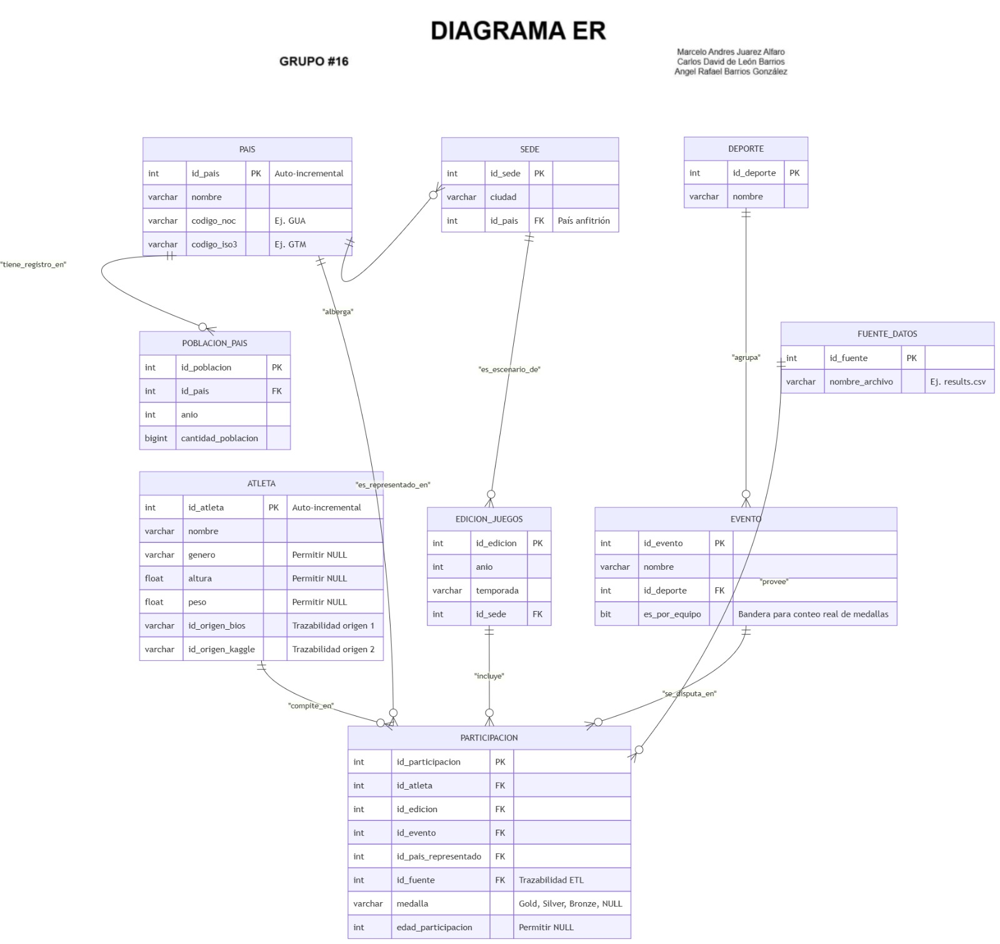

## **4. Plan de Respaldo y Recuperación**

En SQL Server, la estrategia combinada **Full + Diferencial** opera a nivel físico mediante mapas de bits internos llamados **DCM (_Differential Changed Map_)**:

1. **Respaldo Completo (Full Backup):** Copia la totalidad de las páginas de datos ocupadas (extents de 8 páginas de 8 KB c/u) y limpia el mapa DCM, estableciendo la **línea base (Baseline)**.
2. **Respaldos Diferenciales (WITH DIFFERENTIAL):** Registran únicamente las extensiones que han sufrido modificaciones (INSERT, UPDATE, DELETE o divisiones de página por _page splits_) desde el último Full Backup.
   - **Ventaja crítica en restauración:** A diferencia de los respaldos incrementales por cadena que obligan a aplicar cada archivo intermedio (Full + Inc1 + Inc2 + Inc3), los respaldos diferenciales son **acumulativos respecto a la base**. Para restaurar el sistema al punto $N$, únicamente se requiere restaurar **2 archivos**: Full.bak (WITH NORECOVERY) + Diff_N.bak (WITH RECOVERY).

## **5. Ejecución y Evidencias — Escenario 1: Carga por Año**

Para este escenario se creó la instancia limpia OlimpiadasDB_Anio, ejecutando la siguiente secuencia cronológica:

- **Carga Inicial:** Histórico 1896–2014 (338,207 participaciones) $\rightarrow$ **Full Backup**.
- **Sub-carga 1:** Edición **Río 2016** (+17,977 participaciones) $\rightarrow$ **Backup Diferencial 1**.
- **Sub-carga 2:** Edición **Tokio 2020** (+15,120 participaciones) $\rightarrow$ **Backup Diferencial 2**.
- **Sub-carga 3:** Edición **París 2024** (+14,891 participaciones) $\rightarrow$ **Backup Diferencial 3**.

### **5.1 Carga Inicial (1896–2014) y Full Backup**

- **Comando ejecutado:** sqlcmd -S localhost -E -C -i "C:\Backups_Fase2\Scripts\01_Carga_Inicial_Anio.sql"
- **Resultado:** 338,207 filas en PARTICIPACION, 9,900 en POBLACION_PAIS y 51 en EDICION_JUEGOS. Fragmentación inicial de PARTICIPACION: **0.06%** (1,604 páginas).

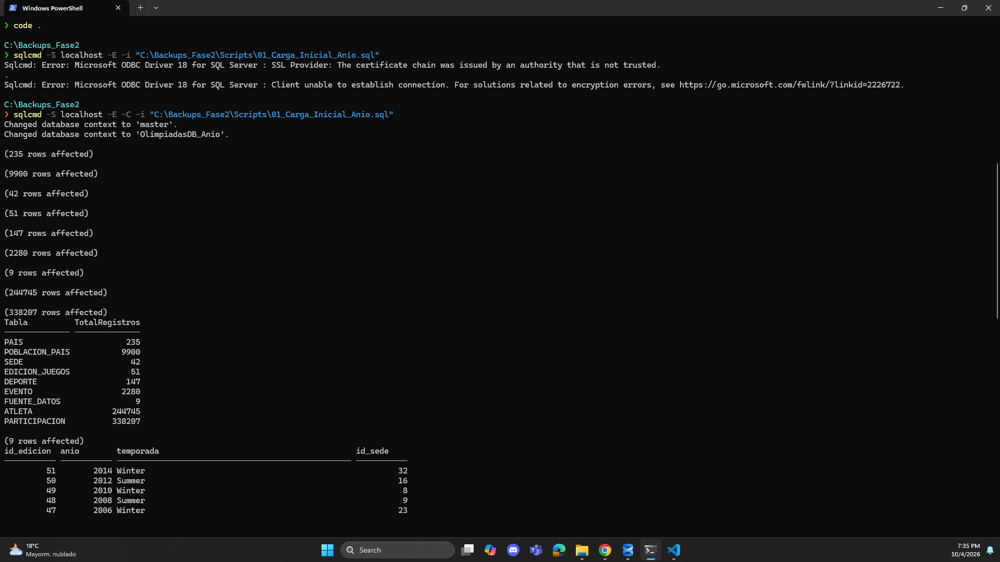

- **Comando Full Backup:** sqlcmd -S localhost -E -C -Q "BACKUP DATABASE OlimpiadasDB_Anio TO DISK = 'C:\Backups_Fase2\Carga_Anio\OlimpiadasDB_Anio_Full.bak' WITH FORMAT, INIT, NAME = 'Full Backup Carga Inicial Anio', STATS = 10;"
- **Métricas del respaldo:** 4,258 páginas procesadas en **0.049 segundos** (678.810 MB/sec).

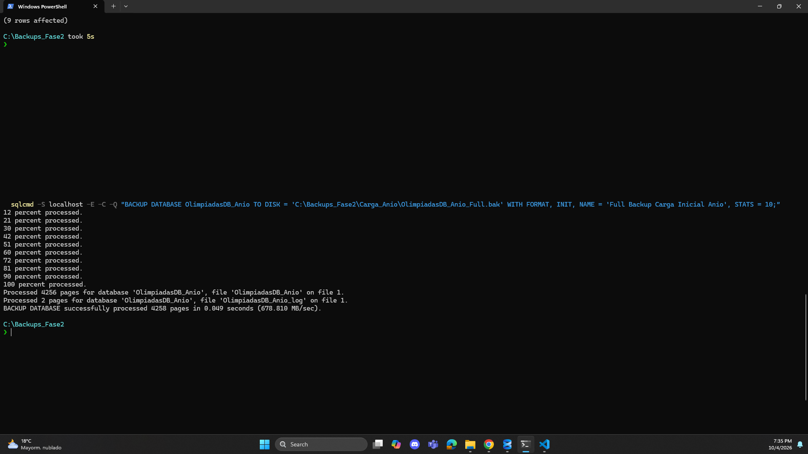

### **5.2 Sub-carga 1: Río 2016 y Backup Diferencial 1**

- **Comando ejecutado:** sqlcmd -S localhost -E -C -i "C:\Backups_Fase2\Scripts\02_Carga_Anio_2016.sql"
- **Resultado:** PARTICIPACION sube a **356,184** registros (+17,977), POBLACION*PAIS a 10,260 y EDICION_JUEGOS a 52. La fragmentación del índice primario de PARTICIPACION se eleva a **91.94%** (3,003 páginas) debido a la inserción de llaves primarias no secuenciales que provocan \_page splits*.

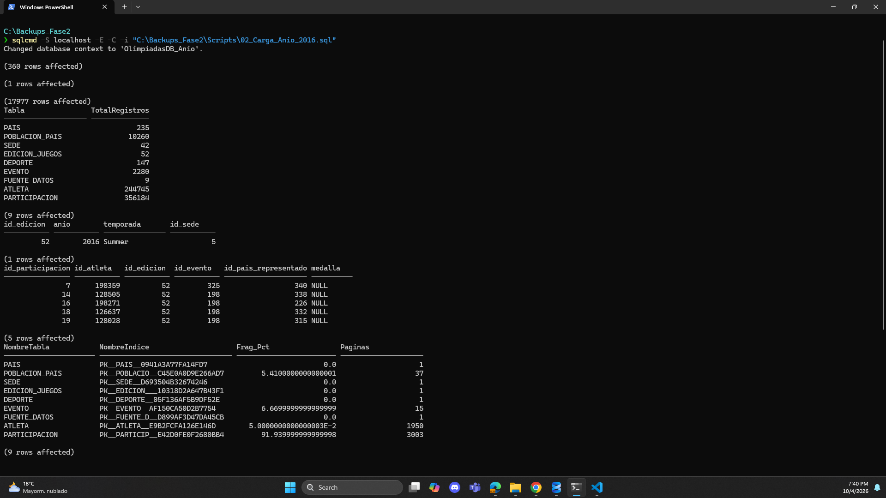

- **Comando Backup Diferencial 1:** sqlcmd -S localhost -E -C -Q "BACKUP DATABASE OlimpiadasDB_Anio TO DISK = 'C:\Backups_Fase2\Carga_Anio\OlimpiadasDB_Anio_Diff_1_2016.bak' WITH DIFFERENTIAL, FORMAT, INIT, NAME = 'Diff Backup 1 - Rio 2016', STATS = 10;"
- **Métricas del respaldo:** 3,162 páginas procesadas en **0.037 segundos** (667.546 MB/sec).

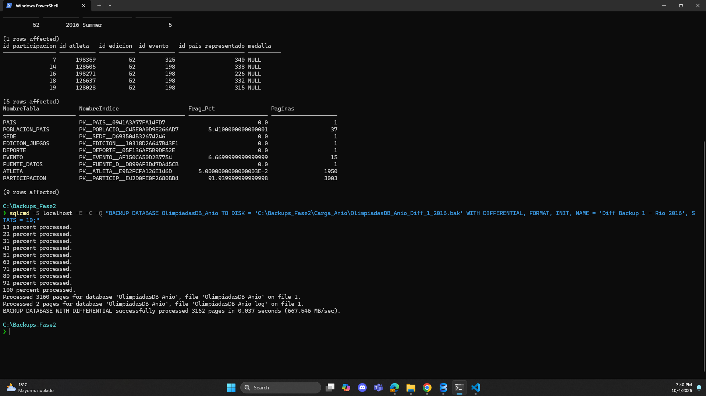

### **5.3 Sub-carga 2: Tokio 2020 y Backup Diferencial 2**

- **Comando ejecutado:** sqlcmd -S localhost -E -C -i "C:\Backups_Fase2\Scripts\03_Carga_Anio_2020.sql"
- **Resultado:** PARTICIPACION sube a **371,304** registros (+15,120), POBLACION_PAIS a 10,980 y EDICION_JUEGOS a 53. Fragmentación de PARTICIPACION: **89.86%** (3,077 páginas).

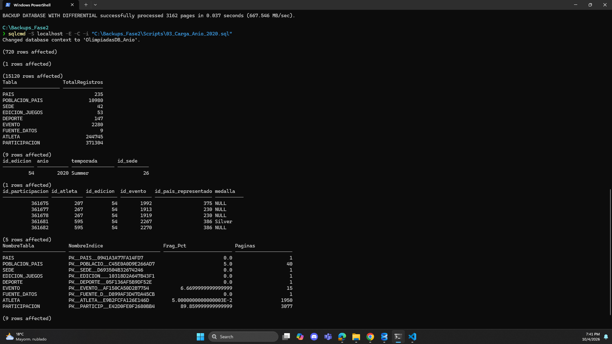

- **Comando Backup Diferencial 2:** sqlcmd -S localhost -E -C -Q "BACKUP DATABASE OlimpiadasDB_Anio TO DISK = 'C:\Backups_Fase2\Carga_Anio\OlimpiadasDB_Anio_Diff_2_2020.bak' WITH DIFFERENTIAL, FORMAT, INIT, NAME = 'Diff Backup 2 - Tokio 2020', STATS = 10;"
- **Métricas del respaldo:** 3,234 páginas procesadas en **0.030 segundos** (842.057 MB/sec).

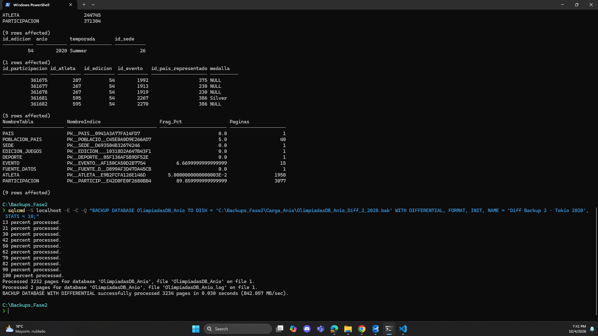

### **5.4 Sub-carga 3: París 2024 y Backup Diferencial 3**

- **Comando ejecutado:** sqlcmd -S localhost -E -C -i "C:\Backups_Fase2\Scripts\04_Carga_Anio_2024.sql"
- **Resultado:** PARTICIPACION alcanza el total histórico de **386,195** registros (+14,891), POBLACION_PAIS llega a 11,520 y EDICION_JUEGOS a 54. Fragmentación de PARTICIPACION: **92.16%** (3,213 páginas).

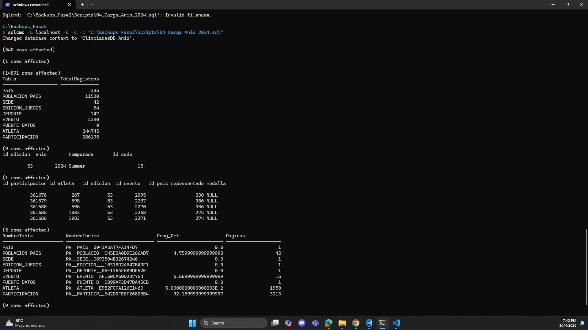

- **Comando Backup Diferencial 3:** sqlcmd -S localhost -E -C -Q "BACKUP DATABASE OlimpiadasDB_Anio TO DISK = 'C:\Backups_Fase2\Carga_Anio\OlimpiadasDB_Anio_Diff_3_2024.bak' WITH DIFFERENTIAL, FORMAT, INIT, NAME = 'Diff Backup 3 - Paris 2024', STATS = 10;"
- **Métricas del respaldo:** 3,378 páginas procesadas en **0.032 segundos** (824.584 MB/sec).

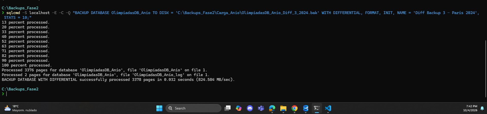

## **6. Eliminación de la Base de Datos, Restauración y Validación Post-Restauración**

Para cada prueba de recuperación se ejecutó DROP DATABASE OlimpiadasDB_Anio seguido de la restauración por consola y el script de auditoría 05_Validar_Restauracion_Anio.sql:

### **6.1 Restauración 1: Solo Full Backup (Estado Inicial 1896–2014)**

- **Tiempo de Restauración:** 4,258 páginas restauradas en **0.069 segundos** (482.053 MB/sec).
- **Validación de Integridad:** PARTICIPACION = 338,207, EDICION_JUEGOS = 51 (última edición: 2014 Winter).

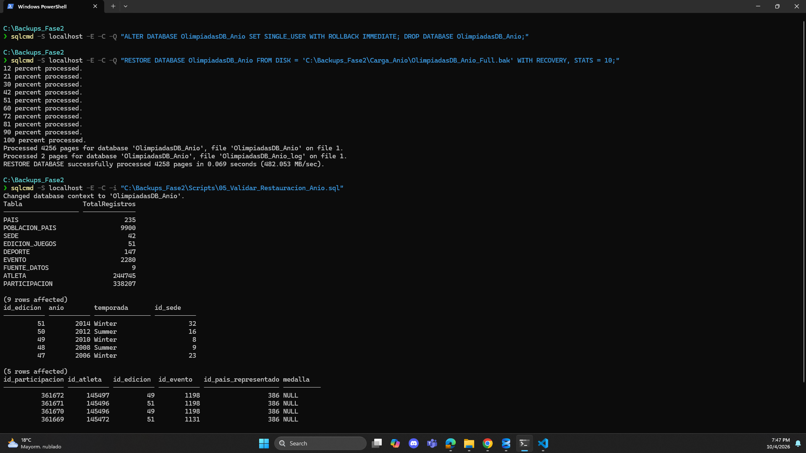

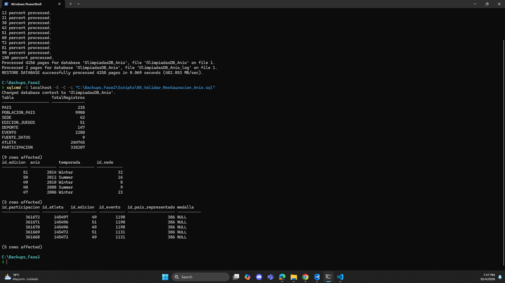

### **6.2 Restauración 2: Full Backup (NORECOVERY) + Diferencial 1 (Río 2016)**

- **Tiempo de Restauración:** Base Full (0.064 s) + Diferencial 1 (3,162 páginas en **0.055 segundos**, 449.076 MB/sec) = **0.119 segundos totales**.
- **Validación de Integridad:** PARTICIPACION = 356,184, EDICION_JUEGOS = 52 (aparece 2016 Summer).

### **6.3 Restauración 3: Full Backup (NORECOVERY) + Diferencial 2 (Tokio 2020)**

- **Tiempo de Restauración:** Base Full (0.069 s) + Diferencial 2 (3,234 páginas en **0.055 segundos**, 459.303 MB/sec) = **0.124 segundos totales**.
- **Validación de Integridad:** PARTICIPACION = 371,304, EDICION_JUEGOS = 53 (aparece 2020 Summer).

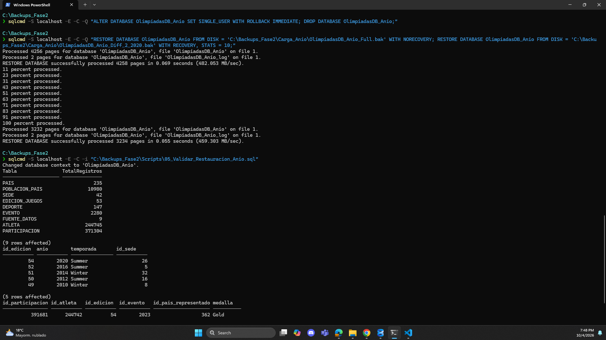

### **6.4 Restauración 4: Full Backup (NORECOVERY) + Diferencial 3 (París 2024 Completo)**

- **Tiempo de Restauración:** Base Full (0.067 s) + Diferencial 3 (3,378 páginas en **0.055 segundos**, 479.758 MB/sec) = **0.122 segundos totales**.
- **Validación de Integridad:** PARTICIPACION = 386,195, EDICION_JUEGOS = 54 (aparece 2024 Summer y el 100% de la información íntegra).

## **7. Tabla Comparativa de Resultados (Escenario 1: Carga por Año)**

| **Operación / Punto de Recuperación** | **Filas en PARTICIPACION** | **Páginas Respaldadas** | **Frag. Índice PARTICIPACION** | **Tiempo de Backup (s)** | **Velocidad Backup (MB/s)** | **Tiempo Restore Individual (s)** | **Tiempo Restore Acumulado (s)** |
| ------------------------------------- | -------------------------- | ----------------------- | ------------------------------ | ------------------------ | --------------------------- | --------------------------------- | -------------------------------- |
| **Carga Inicial + Full Backup**       | 338,207                    | 4,258                   | 0.06 %                         | 0.049 s                  | 678.81                      | 0.069 s                           | **0.069 s**                      |
| **Sub-carga 1 (2016) + Diff 1**       | 356,184                    | 3,162                   | 91.94 %                        | 0.037 s                  | 667.55                      | 0.055 s                           | **0.119 s** _(0.064 + 0.055)_    |
| **Sub-carga 2 (2020) + Diff 2**       | 371,304                    | 3,234                   | 89.86 %                        | 0.030 s                  | 842.06                      | 0.055 s                           | **0.124 s** _(0.069 + 0.055)_    |
| **Sub-carga 3 (2024) + Diff 3**       | 386,195                    | 3,378                   | 92.16 %                        | 0.032 s                  | 824.58                      | 0.055 s                           | **0.122 s** _(0.067 + 0.055)_    |

## **8. Ejecución y Evidencias — Escenario 2: Carga por Deporte (Athletics)**

Para este escenario se creó la instancia OlimpiadasDB_Deporte, ejecutando la siguiente secuencia cronológica enfocada en la disciplina de Athletics:

- **Carga Inicial:** Base de datos sin la disciplina de Athletics en 2016, 2020 y 2024 (377,552 participaciones) $\rightarrow$ **Full Backup**.
- **Sub-carga 1:** Atletismo en Río 2016 (+3,973 participaciones) $\rightarrow$ **Backup Diferencial 1**.
- **Sub-carga 2:** Atletismo en Tokio 2020 (+2,318 participaciones) $\rightarrow$ **Backup Diferencial 2**.
- **Sub-carga 3:** Atletismo en París 2024 (+2,352 participaciones) $\rightarrow$ **Backup Diferencial 3**.

### **8.1 Carga Inicial y Full Backup**

- **Comando ejecutado:** `sqlcmd -S "CARLOSDLB\SQLEXPRESS" -E -C -i "C:\Backups_Fase2\Scripts_Deporte\01_Carga_Inicial_Deporte.sql"`
- **Resultado:** 377,552 filas en PARTICIPACION y 244,745 en ATLETA. La fragmentación inicial del índice principal de PARTICIPACION es del **0.06%** (1,792 páginas).

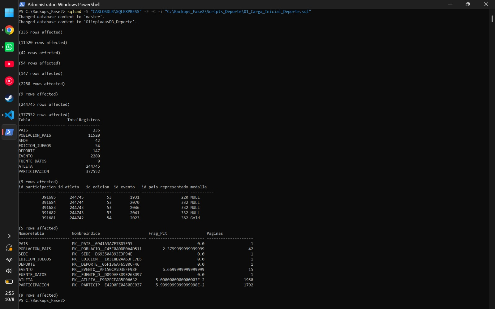

- **Comando Full Backup:** `... BACKUP DATABASE OlimpiadasDB_Deporte TO DISK = ...`
- **Métricas del respaldo:** 4,481 páginas procesadas en **0.069 segundos** (507.267 MB/sec).

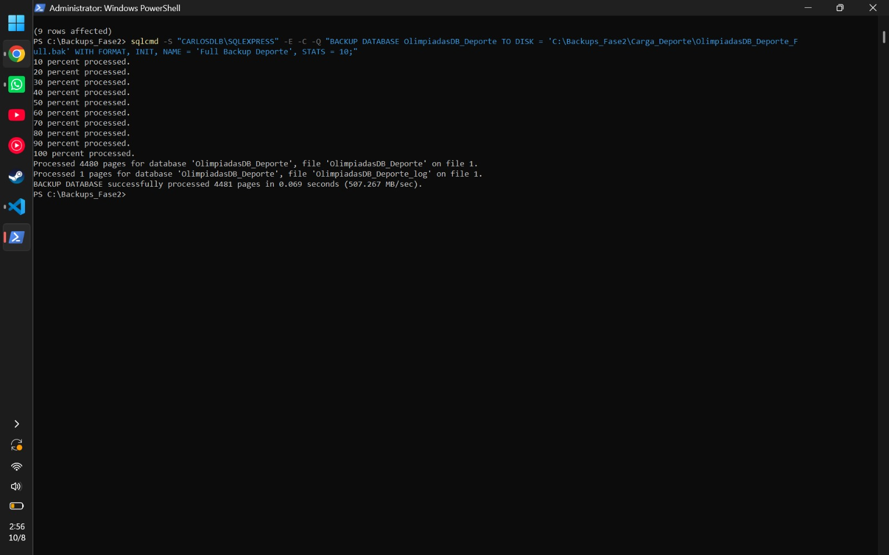

### **8.2 Sub-carga 1: Athletics 2016 y Backup Diferencial 1**

- **Comando ejecutado:** `sqlcmd -S "CARLOSDLB\SQLEXPRESS" -E -C -i "C:\Backups_Fase2\Scripts_Deporte\02_Carga_Deporte_2016.sql"`
- **Resultado:** PARTICIPACION sube a **381,525** registros (+3,973 de Athletics 2016). La fragmentación del índice primario se dispara al **43.19%** (2,292 páginas) debido a las inserciones no secuenciales.

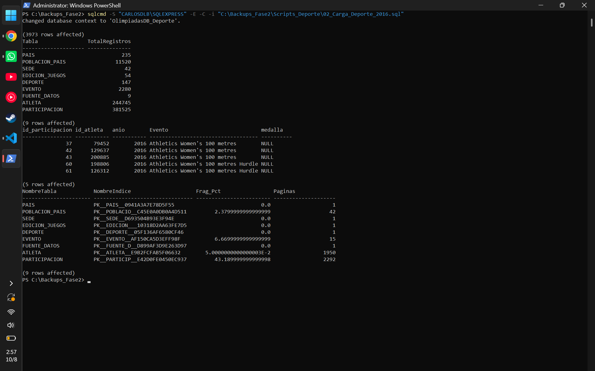

- **Comando Backup Diferencial 1:** `... WITH DIFFERENTIAL ...`
- **Métricas del respaldo:** 1,961 páginas procesadas en **0.451 segundos** (33.955 MB/sec).

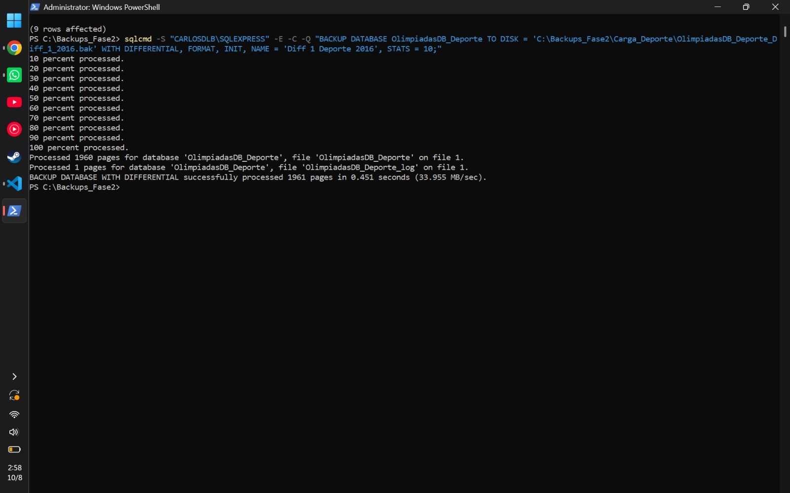

### **8.3 Sub-carga 2: Athletics 2020 y Backup Diferencial 2**

- **Comando ejecutado:** `sqlcmd -S "CARLOSDLB\SQLEXPRESS" -E -C -i "C:\Backups_Fase2\Scripts_Deporte\03_Carga_Deporte_2020.sql"`
- **Resultado:** PARTICIPACION sube a **383,843** registros (+2,318 de Athletics 2020). La fragmentación de la tabla alcanza el **50.60%**.

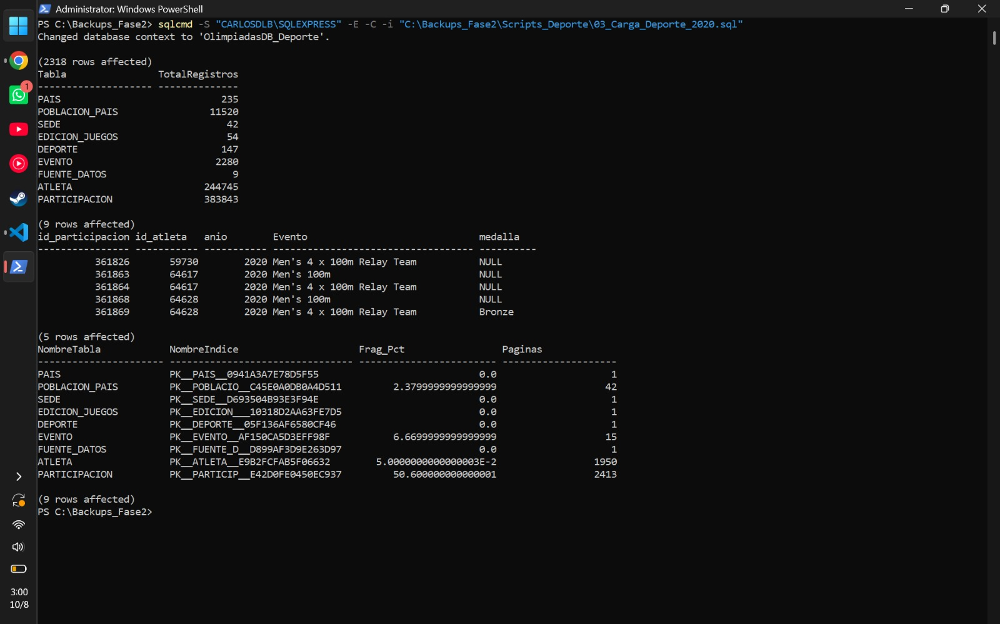

- **Comando Backup Diferencial 2:** `... WITH DIFFERENTIAL ...`
- **Métricas del respaldo:** 2,217 páginas procesadas en **0.203 segundos** (85.290 MB/sec).

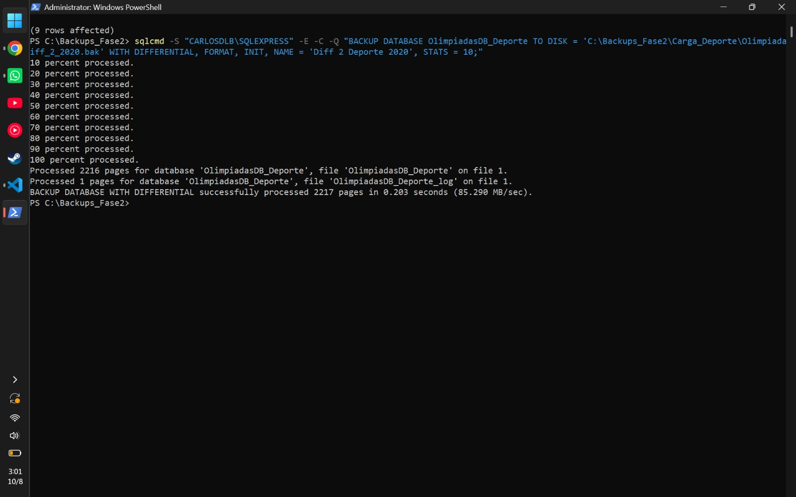

### **8.4 Sub-carga 3: Athletics 2024 y Backup Diferencial 3**

- **Comando ejecutado:** `sqlcmd -S "CARLOSDLB\SQLEXPRESS" -E -C -i "C:\Backups_Fase2\Scripts_Deporte\04_Carga_Deporte_2024.sql"`
- **Resultado:** PARTICIPACION alcanza el total de **386,195** registros (+2,352 de Athletics 2024). Fragmentación de PARTICIPACION se estabiliza en **50.62%** (2,414 páginas).

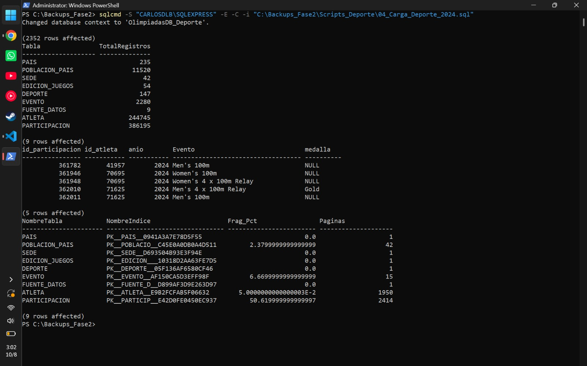

- **Comando Backup Diferencial 3:** `... WITH DIFFERENTIAL ...`
- **Métricas del respaldo:** 2,217 páginas procesadas en **0.191 segundos** (90.649 MB/sec).

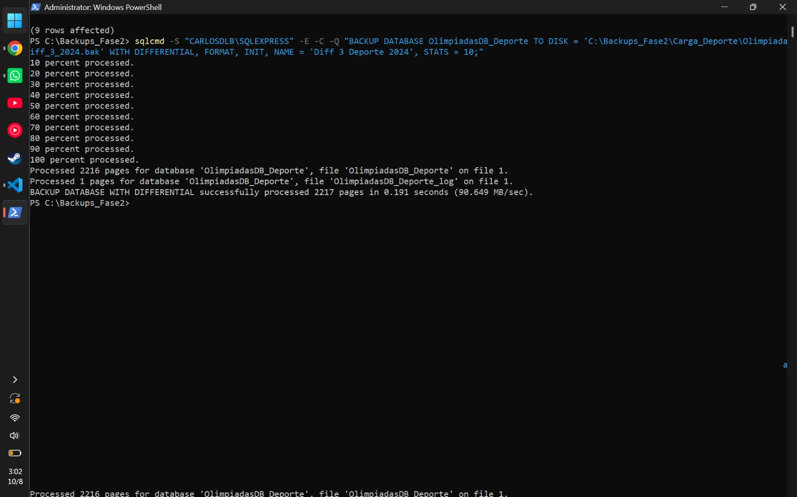

## **9. Eliminación de la Base de Datos, Restauración y Validación**

Para cada prueba de recuperación se ejecutó `DROP DATABASE OlimpiadasDB_Deporte` seguido de la restauración en consola mediante `sqlcmd`.

### **9.1 Restauración 1: Solo Full Backup (Estado Inicial sin Athletics 16-24)**

- **Tiempo de Restauración:** 4,481 páginas restauradas en **0.079 segundos** (443.056 MB/sec).
- **Validación de Integridad:** Se confirman 377,552 filas. En el conteo por año, el registro más reciente de Athletics es 2012 (3,810 participaciones).

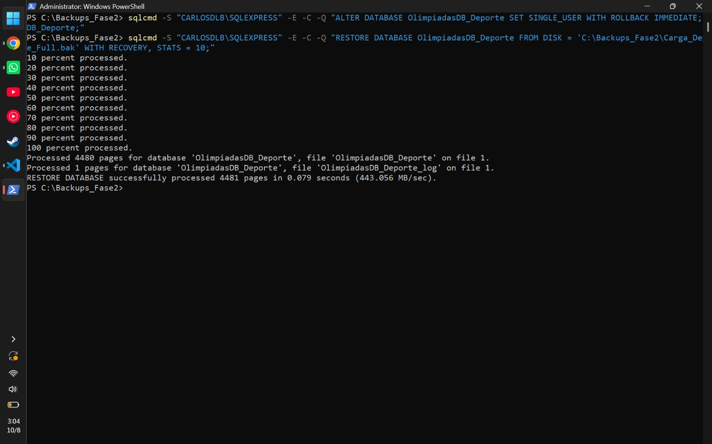

### **9.2 Restauración 2: Full Backup (NORECOVERY) + Diferencial 1 (Athletics 2016)**

- **Tiempo de Restauración:** Base Full (0.082 s) + Diferencial 1 (1,961 páginas en **0.041 segundos**) = **0.123 segundos totales**.
- **Validación de Integridad:** Se confirman 381,525 filas. Aparece exitosamente Athletics 2016 con 3,973 participaciones.

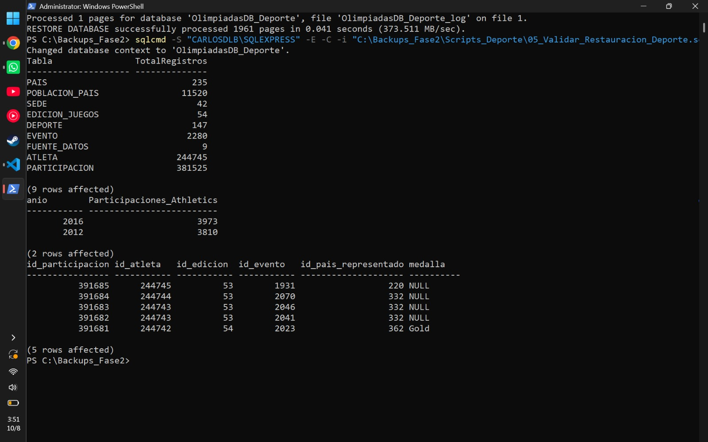

### **9.3 Restauración 3: Full Backup (NORECOVERY) + Diferencial 2 (Athletics 2020)**

- **Tiempo de Restauración:** Base Full (0.084 s) + Diferencial 2 (2,217 páginas en **0.048 segundos**) = **0.132 segundos totales**.
- **Validación de Integridad:** Se confirman 383,843 filas. Se integra Athletics 2020 con 2,318 participaciones.

[Inserta aquí tu Captura 11]

### **9.4 Restauración 4: Full Backup (NORECOVERY) + Diferencial 3 (Athletics 2024 Completo)**

- **Tiempo de Restauración:** Base Full (0.088 s) + Diferencial 3 (2,217 páginas en **0.050 segundos**) = **0.138 segundos totales**.
- **Validación de Integridad:** Se recupera el 100% de la información (386,195 filas). Athletics 2024 aparece con sus 2,352 registros intactos.

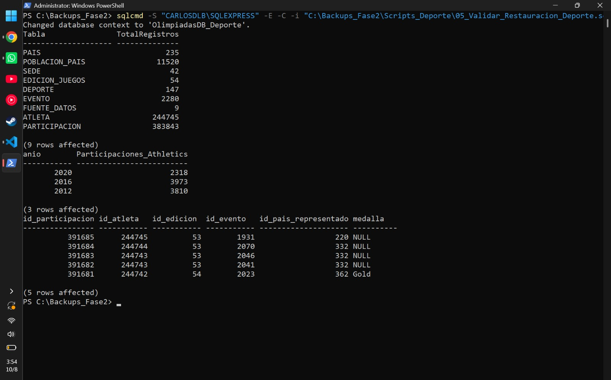

## **10. Tabla Comparativa de Resultados (Escenario 2: Carga por Deporte - Athletics)**

| **Operación / Punto de Recuperación** | **Filas en PARTICIPACION** | **Páginas Respaldadas** | **Frag. Índice PARTICIPACION** | **Tiempo de Backup (s)** | **Velocidad Backup (MB/s)** | **Tiempo Restore Individual (s)** | **Tiempo Restore Acumulado (s)** |
| ------------------------------------- | -------------------------- | ----------------------- | ------------------------------ | ------------------------ | --------------------------- | --------------------------------- | -------------------------------- |
| **Carga Inicial + Full Backup**       | 377,552                    | 4,481                   | 0.06 %                         | 0.069 s                  | 507.27                      | 0.079 s                           | 0.079 s                          |
| **Sub-carga 1 (2016) + Diff 1**       | 381,525                    | 1,961                   | 43.19 %                        | 0.451 s                  | 33.95                       | 0.041 s                           | 0.123 s (0.082 + 0.041)          |
| **Sub-carga 2 (2020) + Diff 2**       | 383,843                    | 2,217                   | 50.60 %                        | 0.203 s                  | 85.29                       | 0.048 s                           | 0.132 s (0.084 + 0.048)          |
| **Sub-carga 3 (2024) + Diff 3**       | 386,195                    | 2,217                   | 50.62 %                        | 0.191 s                  | 90.65                       | 0.050 s                           | 0.138 s (0.088 + 0.050)          |

## **11. Ejecución y Evidencias — Escenario 3: Carga por Deportista (Usain Bolt)**

Para este escenario se creó la instancia OlimpiadasDB_Atleta (modelo de recuperación FULL), copiando la base depurada OlimpiadasDB y ejecutando la siguiente secuencia cronológica enfocada en el deportista Usain Bolt:

- **Carga Inicial:** Base de datos completa sin las participaciones de Usain Bolt en 2004, 2008 y 2012 (386,187 participaciones) → **Full Backup**.
- **Sub-carga 1:** Usain Bolt en Atenas 2004 (+2 participaciones) → **Backup Diferencial 1**.
- **Sub-carga 2:** Usain Bolt en Pekín 2008 (+3 participaciones) → **Backup Diferencial 2**.
- **Sub-carga 3:** Usain Bolt en Londres 2012 (+3 participaciones) → **Backup Diferencial 3**.

**Equipo de pruebas del Escenario 3**

| **Parámetro**                 | **Especificación**                                                                                          |
| ----------------------------- | ----------------------------------------------------------------------------------------------------------- |
| **Host**                      | DESKTOP-67RDTPJ (localhost, instancia por defecto MSSQLSERVER)                                              |
| **Sistema Gestor (DBMS)**     | Microsoft SQL Server 2025 (RTM) 17.0.1000.7 (X64), Standard Developer Edition (64-bit)                      |
| **Sistema operativo**         | Windows 11 Home Single Language, compilación 26200 (SQL Server lo reporta como "Windows 10 10.0 Build 26200") |
| **Procesador**                | 12th Gen Intel(R) Core(TM) i5-12450H (8 núcleos, 12 procesadores lógicos)                                          |
| **Memoria RAM**               | 15.7 GB                                                                                             |
| **Almacenamiento**            | SSD Samsung MZVL2512HCJQ-00BH1, 512 GB (512,110,190,592 bytes)                                                            |
| **Herramienta de consola**    | sqlcmd (flag -C habilitado), ejecutado desde el Símbolo del sistema (CMD)                                   |
| **Ruta de respaldos**         | C:\Backups_Fase2\Carga_Deportista\                                                                          |

### **11.1 Carga Inicial y Full Backup**

- **Comando ejecutado:** `sqlcmd -S localhost -E -C -i "C:\Backups_Fase2\Scripts_Deportista\01_Carga_Inicial_Deportista.sql"`
- **Resultado:** 386,187 filas en PARTICIPACION, 244,745 en ATLETA, 11,520 en POBLACION_PAIS y 54 en EDICION_JUEGOS. Fragmentación inicial del índice primario de PARTICIPACION: **0.05%** (1,832 páginas).
- **Fecha y hora (reloj de Windows):** 10/10/2026, 10:30 p. m.

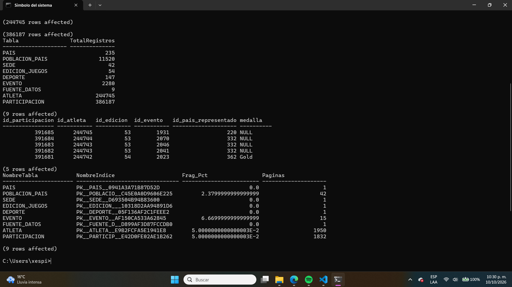

- **Comando Full Backup:** `sqlcmd -S localhost -E -C -Q "BACKUP DATABASE OlimpiadasDB_Atleta TO DISK = 'C:\Backups_Fase2\Carga_Deportista\OlimpiadasDB_Atleta_Full.bak' WITH FORMAT, INIT, NAME = 'Full Backup Atleta', STATS = 10;"`
- **Métricas del respaldo:** 4,538 páginas procesadas (4,536 de datos + 2 de log) en **0.044 segundos** (805.664 MB/sec).
- **Fecha y hora (reloj de Windows):** 10/10/2026, 10:34 p. m.

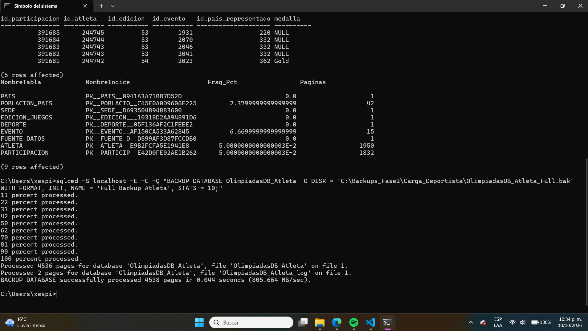

### **11.2 Sub-carga 1: Usain Bolt 2004 y Backup Diferencial 1**

- **Comando ejecutado:** `sqlcmd -S localhost -E -C -i "C:\Backups_Fase2\Scripts_Deportista\02_Carga_Bolt_2004.sql"`
- **Resultado:** PARTICIPACION sube a **386,189** registros (+2 de Usain Bolt en 2004). Las demás tablas no cambian. La fragmentación del índice primario de PARTICIPACION pasa a **0.16%** (1,833 páginas).
- **Fecha y hora (reloj de Windows):** 10/10/2026, 10:48 p. m.

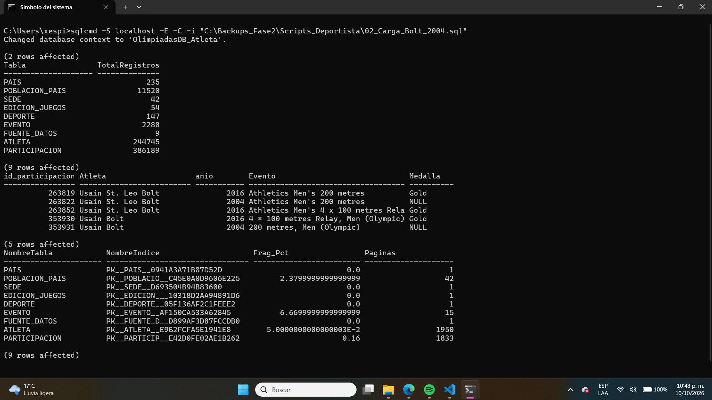

- **Comando Backup Diferencial 1:** `sqlcmd -S localhost -E -C -Q "BACKUP DATABASE OlimpiadasDB_Atleta TO DISK = 'C:\Backups_Fase2\Carga_Deportista\OlimpiadasDB_Atleta_Diff_1_2004.bak' WITH DIFFERENTIAL, FORMAT, INIT, NAME = 'Diff 1 Bolt 2004', STATS = 10;"`
- **Métricas del respaldo:** 282 páginas procesadas (280 de datos + 2 de log) en **0.028 segundos** (78.543 MB/sec).
- **Fecha y hora (reloj de Windows):** 10/10/2026, 10:54 p. m.

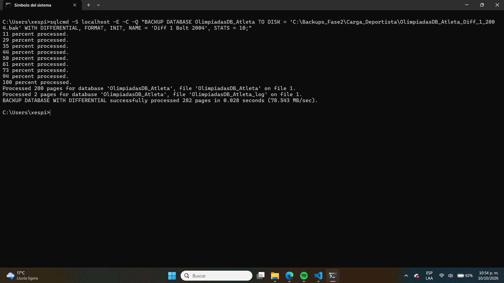

### **11.3 Sub-carga 2: Usain Bolt 2008 y Backup Diferencial 2**

- **Comando ejecutado:** `sqlcmd -S localhost -E -C -i "C:\Backups_Fase2\Scripts_Deportista\03_Carga_Bolt_2008.sql"`
- **Resultado:** PARTICIPACION sube a **386,192** registros (+3 de Usain Bolt en 2008). La fragmentación de PARTICIPACION pasa a **0.38%** (1,835 páginas).
- **Fecha y hora (reloj de Windows):** 11/10/2026, 12:27 p. m.

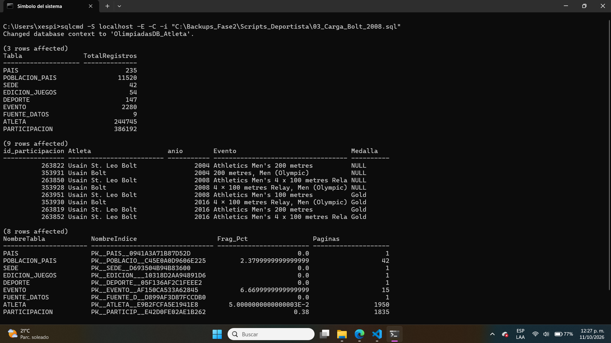

- **Comando Backup Diferencial 2:** `sqlcmd -S localhost -E -C -Q "BACKUP DATABASE OlimpiadasDB_Atleta TO DISK = 'C:\Backups_Fase2\Carga_Deportista\OlimpiadasDB_Atleta_Diff_2_2008.bak' WITH DIFFERENTIAL, FORMAT, INIT, NAME = 'Diff 2 Bolt 2008', STATS = 10;"`
- **Métricas del respaldo:** 314 páginas procesadas (312 de datos + 2 de log) en **0.022 segundos** (111.328 MB/sec).
- **Fecha y hora (reloj de Windows):** 11/10/2026, 12:28 p. m.

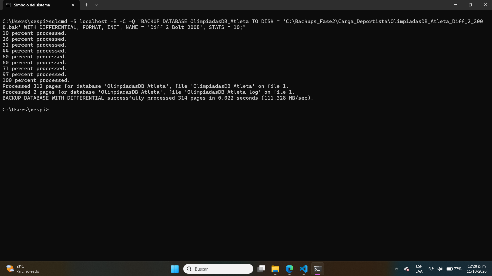

### **11.4 Sub-carga 3: Usain Bolt 2012 y Backup Diferencial 3**

- **Comando ejecutado:** `sqlcmd -S localhost -E -C -i "C:\Backups_Fase2\Scripts_Deportista\04_Carga_Bolt_2012.sql"`
- **Resultado:** PARTICIPACION alcanza el total de **386,195** registros (+3 de Usain Bolt en 2012), igual a la base fuente OlimpiadasDB. La fragmentación de PARTICIPACION se mantiene en **0.38%** (1,835 páginas).
- **Fecha y hora (reloj de Windows):** 11/10/2026, 08:17 p. m.

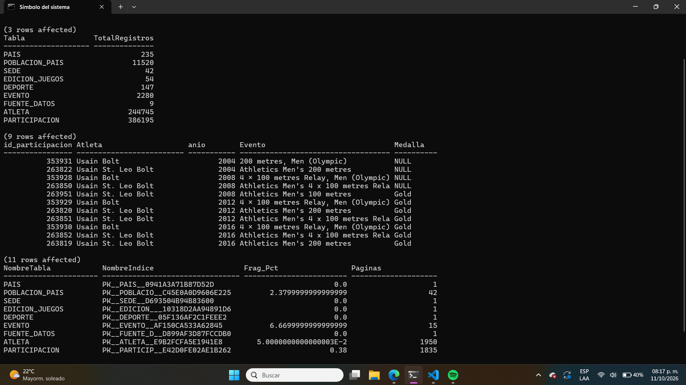

- **Comando Backup Diferencial 3:** `sqlcmd -S localhost -E -C -Q "BACKUP DATABASE OlimpiadasDB_Atleta TO DISK = 'C:\Backups_Fase2\Carga_Deportista\OlimpiadasDB_Atleta_Diff_3_2012.bak' WITH DIFFERENTIAL, FORMAT, INIT, NAME = 'Diff 3 Bolt 2012', STATS = 10;"`
- **Métricas del respaldo:** 386 páginas procesadas (384 de datos + 2 de log) en **0.029 segundos** (103.852 MB/sec).
- **Fecha y hora (reloj de Windows):** 11/10/2026, 08:19 p. m.

## **12. Eliminación de la Base de Datos, Restauración y Validación (Escenario 3)**

Para cada prueba de recuperación se ejecutó `ALTER DATABASE OlimpiadasDB_Atleta SET SINGLE_USER WITH ROLLBACK IMMEDIATE; DROP DATABASE OlimpiadasDB_Atleta;` seguido de la restauración por consola y del script de auditoría `05_Validar_Restauracion_Deportista.sql`. En cada ciclo la validación muestra el conteo de las 9 tablas y las participaciones de Usain Bolt presentes en la base restaurada.

### **12.1 Restauración 1: Solo Full Backup (Estado Inicial sin Bolt 2004, 2008 y 2012)**

- **Comando de restauración:** `sqlcmd -S localhost -E -C -Q "RESTORE DATABASE OlimpiadasDB_Atleta FROM DISK = 'C:\Backups_Fase2\Carga_Deportista\OlimpiadasDB_Atleta_Full.bak' WITH RECOVERY, STATS = 10;"`
- **Tiempo de Restauración:** 4,538 páginas restauradas en **0.063 segundos** (562.686 MB/sec).
- **Validación de Integridad:** PARTICIPACION = 386,187. En la muestra de Usain Bolt solo aparecen 3 registros, todos de 2016 (no hay registros de 2004, 2008 ni 2012).
- **Fecha y hora (reloj de Windows):** 11/10/2026, 08:32 p. m.

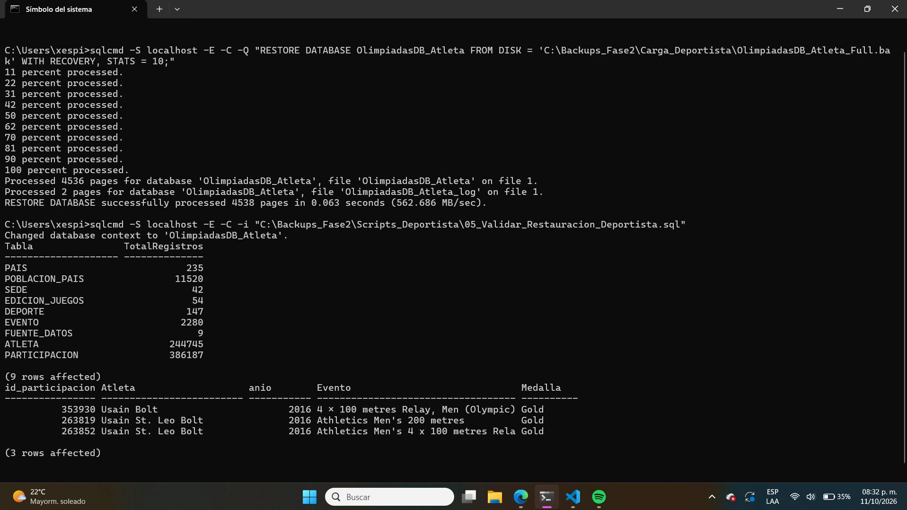

### **12.2 Restauración 2: Full Backup (NORECOVERY) + Diferencial 1 (Bolt 2004)**

- **Comando de restauración:** `sqlcmd -S localhost -E -C -Q "RESTORE DATABASE OlimpiadasDB_Atleta FROM DISK = 'C:\Backups_Fase2\Carga_Deportista\OlimpiadasDB_Atleta_Full.bak' WITH NORECOVERY; RESTORE DATABASE OlimpiadasDB_Atleta FROM DISK = 'C:\Backups_Fase2\Carga_Deportista\OlimpiadasDB_Atleta_Diff_1_2004.bak' WITH RECOVERY, STATS = 10;"`
- **Tiempo de Restauración:** Base Full (0.067 s) + Diferencial 1 (282 páginas en **0.041 segundos**, 53.639 MB/sec) = **0.108 segundos totales**.
- **Validación de Integridad:** PARTICIPACION = 386,189. Aparecen los 2 registros de Usain Bolt en 2004 (5 registros de Bolt en total).
- **Fecha y hora (reloj de Windows):** 11/10/2026, 08:34 p. m.

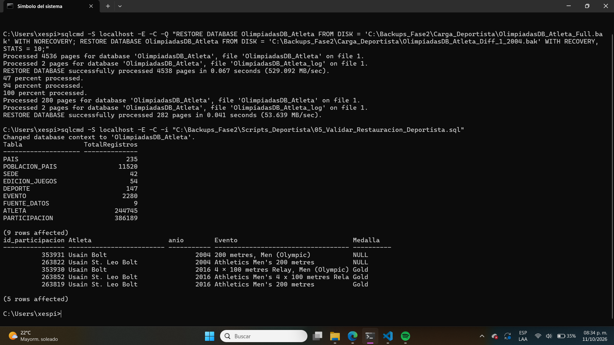

### **12.3 Restauración 3: Full Backup (NORECOVERY) + Diferencial 2 (Bolt 2008)**

- **Comando de restauración:** igual al anterior, usando `OlimpiadasDB_Atleta_Diff_2_2008.bak` como respaldo diferencial.
- **Tiempo de Restauración:** Base Full (0.062 s) + Diferencial 2 (314 páginas en **0.044 segundos**, 55.664 MB/sec) = **0.106 segundos totales**.
- **Validación de Integridad:** PARTICIPACION = 386,192. Se integran los 3 registros de Usain Bolt en 2008 (8 registros de Bolt en total).
- **Fecha y hora (reloj de Windows):** 11/10/2026, 08:35 p. m.

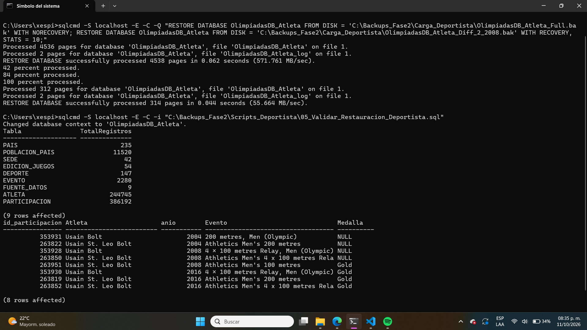

### **12.4 Restauración 4: Full Backup (NORECOVERY) + Diferencial 3 (Bolt 2012 Completo)**

- **Comando de restauración:** igual al anterior, usando `OlimpiadasDB_Atleta_Diff_3_2012.bak` como respaldo diferencial.
- **Tiempo de Restauración:** Base Full (0.062 s) + Diferencial 3 (386 páginas en **0.041 segundos**, 73.456 MB/sec) = **0.103 segundos totales**.
- **Validación de Integridad:** Se recupera el 100% de la información (386,195 filas en PARTICIPACION). Aparecen los 11 registros de Usain Bolt (2004, 2008, 2012 y 2016), idénticos a los mostrados tras la última sub-carga.
- **Fecha y hora (reloj de Windows):** 11/10/2026, 08:36 p. m.

## **13. Tabla Comparativa de Resultados (Escenario 3: Carga por Deportista - Usain Bolt)**

| **Operación / Punto de Recuperación** | **Filas en PARTICIPACION** | **Páginas Respaldadas** | **Frag. Índice PARTICIPACION** | **Tiempo de Backup (s)** | **Velocidad Backup (MB/s)** | **Tiempo Restore Individual (s)** | **Tiempo Restore Acumulado (s)** |
| ------------------------------------- | -------------------------- | ----------------------- | ------------------------------ | ------------------------ | --------------------------- | --------------------------------- | -------------------------------- |
| **Carga Inicial + Full Backup**       | 386,187                    | 4,538                   | 0.05 %                         | 0.044 s                  | 805.66                      | 0.063 s                           | **0.063 s**                      |
| **Sub-carga 1 (2004) + Diff 1**       | 386,189                    | 282                     | 0.16 %                         | 0.028 s                  | 78.54                       | 0.041 s                           | **0.108 s** _(0.067 + 0.041)_    |
| **Sub-carga 2 (2008) + Diff 2**       | 386,192                    | 314                     | 0.38 %                         | 0.022 s                  | 111.33                      | 0.044 s                           | **0.106 s** _(0.062 + 0.044)_    |
| **Sub-carga 3 (2012) + Diff 3**       | 386,195                    | 386                     | 0.38 %                         | 0.029 s                  | 103.85                      | 0.041 s                           | **0.103 s** _(0.062 + 0.041)_    |

_Las páginas respaldadas incluyen 2 páginas de log en cada respaldo. Cada tiempo corresponde a una sola medición._

**Archivos de respaldo generados (Carga_Deportista)**

| **Archivo**                               | **Tamaño (bytes)** | **Fecha y hora de creación** |
| ----------------------------------------- | ------------------ | ---------------------------- |
| OlimpiadasDB_Atleta_Full.bak              | 38,920,192         | 10/10/2026, 10:32 p. m.      |
| OlimpiadasDB_Atleta_Diff_1_2004.bak       | 4,317,184          | 10/10/2026, 10:53 p. m.      |
| OlimpiadasDB_Atleta_Diff_2_2008.bak       | 4,317,184          | 11/10/2026, 12:28 p. m.      |
| OlimpiadasDB_Atleta_Diff_3_2012.bak       | 4,317,184          | 11/10/2026, 08:18 p. m.      |

### **13.1 Observaciones del Escenario 3**

- **Volumen de carga mínimo:** cada sub-carga agrega solo 2 o 3 filas (las participaciones de un único deportista), por lo que los diferenciales son pequeños: 282, 314 y 386 páginas, equivalentes al 6.2%, 6.9% y 8.5% de las 4,538 páginas del Full.
- **Fragmentación casi nula:** el índice primario de PARTICIPACION pasa de 0.05% a 0.38% tras las tres sub-cargas, porque con tan pocas inserciones apenas se producen divisiones de página (_page splits_).
- **Diferenciales acumulativos:** las páginas de datos crecen de 280 a 312 y a 384 porque cada diferencial contiene todo lo modificado desde el Full. Por eso, para restaurar cualquier punto solo se necesitan 2 archivos (Full + el diferencial deseado). Aun así, los tres archivos `.bak` pesan lo mismo (4,317,184 bytes), por lo que a esta escala el número de páginas es mejor métrica que el tamaño del archivo.
- **Tiempos de restauración:** restaurar Full + Diferencial toma entre 0.103 s y 0.108 s, alrededor de 1.6 a 1.7 veces lo que toma restaurar solo el Full (0.063 s), ya que son dos operaciones. El tiempo de restaurar el diferencial se mantiene casi constante (0.041 a 0.044 s) aunque sus páginas aumentan. Al tratarse de milésimas de segundo y de una sola medición por caso, estas diferencias deben interpretarse con cautela.
- **Dos registros de Usain Bolt:** la base conserva dos registros de atleta para Bolt ("Usain St. Leo Bolt" y "Usain Bolt"), por lo que algunas pruebas aparecen dos veces (por ejemplo, los 200 metros de 2004). Es una particularidad de los datos de la Fase 1 y no afecta el procedimiento de respaldo ni de restauración.

## **14. Análisis Comparativo y Conclusiones**

Esta sección compara los tres escenarios de carga (por año, por deporte y por deportista) para responder a la pregunta central del proyecto: **¿qué estrategia de respaldo conviene más, Full o Diferencial, para el volumen de datos manejado?** Se comparan dos estrategias:

- **Estrategia A (Full en cada respaldo):** se saca un respaldo completo cada vez. No se ejecutó como tal; se estima a partir del tamaño del Full de cada escenario.
- **Estrategia B (Full inicial + diferenciales):** la ejecutada en los tres escenarios, con un Full seguido de tres diferenciales acumulativos.

### **14.1 Condiciones de medición**

| **Escenario** | **Integrante** | **Host / instancia** | **DBMS** | **Procesador, RAM y disco** | **Filas iniciales** | **Filas agregadas por sub-carga** | **Filas finales** |
| ------------- | -------------- | -------------------- | -------- | --------------------------- | ------------------- | --------------------------------- | ----------------- |
| **1. Carga por Año** | Marcelo | DESKTOP-A6VV3AL (instancia MSSQL17.MSSQLSERVER) | SQL Server 2025 (RTM) 17.0.1000.7, Standard Developer Edition | Intel Core i5-13420H (8 núcleos, 12 hilos), 16 GB RAM, SSD Kingston NVMe 1 TB | 338,207 | +17,977 / +15,120 / +14,891 | 386,195 |
| **2. Carga por Deporte** | Carlos | CARLOSDLB\SQLEXPRESS | SQL Server 2025 (RTM) 17.0.1000.7, Standard Developer Edition | AMD Ryzen 5 6600H (6 núcleos, 12 hilos), 16 GB RAM, SSD WD Blue SN570 512 GB | 377,552 | +3,973 / +2,318 / +2,352 | 386,195 |
| **3. Carga por Deportista** | Rafa | DESKTOP-67RDTPJ (instancia MSSQLSERVER) | SQL Server 2025 (RTM) 17.0.1000.7, Standard Developer Edition | Intel Core i5-12450H (8 núcleos, 12 hilos), 15.7 GB, SSD Samsung 512 GB | 386,187 | +2 / +3 / +3 | 386,195 |

**Aclaraciones sobre la comparabilidad:** cada escenario se midió en una computadora distinta, con una sola ejecución por operación, salvo los diferenciales del Escenario 2, que se ejecutaron varias veces y cuyos valores (entre 0.19 s y 0.45 s) corresponden a mediciones distintas. Todos los tiempos son de milésimas de segundo, por lo que las diferencias pequeñas entre escenarios no deben interpretarse como concluyentes. Por eso el análisis se apoya sobre todo en las **páginas respaldadas** y en el **espacio en disco**, que son métricas más estables que el tiempo.

### **14.2 Tablas comparativas consolidadas**

**Tabla 1. Respaldos (Full y Diferenciales)**

| **Escenario** | **Respaldo** | **Páginas** | **% de las páginas del Full** | **Tiempo (s)** | **Velocidad (MB/s)** | **Tamaño del archivo (MB)** | **Frag. índice PARTICIPACION** |
| ------------- | ------------ | ----------- | ----------------------------- | -------------- | -------------------- | --------------------------- | ------------------------------ |
| **1. Año** | Full | 4,258 | 100 % | 0.049 | 678.81 | 36.82 | 0.06 % |
| | Diferencial 1 | 3,162 | 74.3 % | 0.037 | 667.55 | 27.39 | 91.94 % |
| | Diferencial 2 | 3,234 | 76.0 % | 0.030 | 842.06 | 28.43 | 89.86 % |
| | Diferencial 3 | 3,378 | 79.3 % | 0.032 | 824.58 | 29.48 | 92.16 % |
| **2. Deporte** | Full | 4,481 | 100 % | 0.069 | 507.27 | 36.79 | 0.06 % |
| | Diferencial 1 | 1,961 | 43.8 % | 0.451 | 33.95 | 16.15 | 43.19 % |
| | Diferencial 2 | 2,217 | 49.5 % | 0.203 | 85.29 | 18.25 | 50.60 % |
| | Diferencial 3 | 2,217 | 49.5 % | 0.191 | 90.65 | 18.25 | 50.62 % |
| **3. Deportista** | Full | 4,538 | 100 % | 0.044 | 805.66 | 38.92 | 0.05 % |
| | Diferencial 1 | 282 | 6.2 % | 0.028 | 78.54 | 4.32 | 0.16 % |
| | Diferencial 2 | 314 | 6.9 % | 0.022 | 111.33 | 4.32 | 0.38 % |
| | Diferencial 3 | 386 | 8.5 % | 0.029 | 103.85 | 4.32 | 0.38 % |

_Las páginas incluyen las páginas del log de cada respaldo. Tamaños en MB decimales, tomados del listado de los archivos `.bak` de cada escenario._

**Tabla 2. Restauración (tiempo acumulado)**

| **Escenario** | **Solo Full (s)** | **Full + Dif. 1 (s)** | **Full + Dif. 2 (s)** | **Full + Dif. 3 (s)** |
| ------------- | ----------------- | --------------------- | --------------------- | --------------------- |
| **1. Año** | 0.069 | 0.119 (1.72 veces, +0.050 s) | 0.124 (1.80 veces, +0.055 s) | 0.122 (1.77 veces, +0.053 s) |
| **2. Deporte** | 0.079 | 0.123 (1.56 veces, +0.044 s) | 0.132 (1.67 veces, +0.053 s) | 0.138 (1.75 veces, +0.059 s) |
| **3. Deportista** | 0.063 | 0.108 (1.71 veces, +0.045 s) | 0.106 (1.68 veces, +0.043 s) | 0.103 (1.63 veces, +0.040 s) |

_Las razones y los segundos adicionales son respecto a restaurar solo el Full del mismo escenario._

**Tabla 3. Espacio en disco: Full + 3 diferenciales frente a 4 respaldos Full**

| **Escenario** | **Full (MB)** | **Suma de los 3 diferenciales (MB)** | **Estrategia B: Full + 3 Dif. (MB)** | **Estrategia A: 4 Full (MB)** | **Ahorro de B frente a A** |
| ------------- | ------------- | ------------------------------------ | ------------------------------------ | ----------------------------- | -------------------------- |
| **1. Año** | 36.82 | 85.30 | 122.13 | 147.29 | 25.17 MB (17.1 %) |
| **2. Deporte** | 36.79 | 52.64 | 89.43 | 147.17 | 57.74 MB (39.2 %) |
| **3. Deportista** | 38.92 | 12.95 | 51.87 | 155.68 | 103.81 MB (66.7 %) |

_La Estrategia A se estima multiplicando por 4 el tamaño del Full inicial; los Full posteriores serían algo mayores, por lo que el ahorro real sería ligeramente superior._

### **14.3 Análisis de los respaldos**

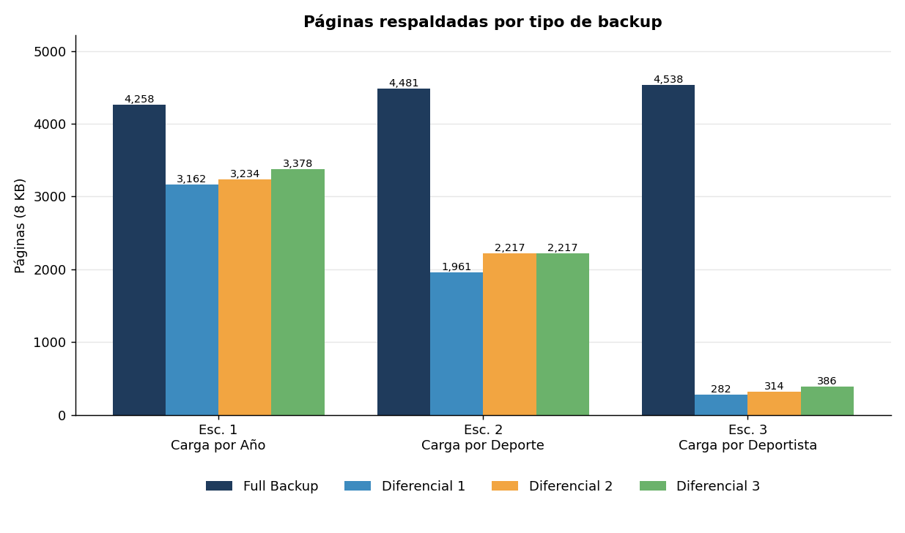

El tamaño del diferencial depende directamente de cuánto cambió la base desde el Full. En el Escenario 3, donde solo se agregaron entre 2 y 8 filas, los diferenciales ocupan entre 6.2 % y 8.5 % de las páginas del Full. En el Escenario 2 (entre 4,000 y 8,600 filas acumuladas) ocupan entre 43.8 % y 49.5 %, y en el Escenario 1 (entre 18,000 y 48,000 filas acumuladas) llegan al 74.3 % a 79.3 %. Como los diferenciales son **acumulativos**, cada uno contiene todo lo modificado desde el Full, por eso sus páginas no disminuyen de un respaldo al siguiente.

Un diferencial respalda extensiones completas (bloques de 8 páginas), por lo que incluso un cambio mínimo toca cientos de páginas: 8 filas del Escenario 3 generaron 386 páginas.

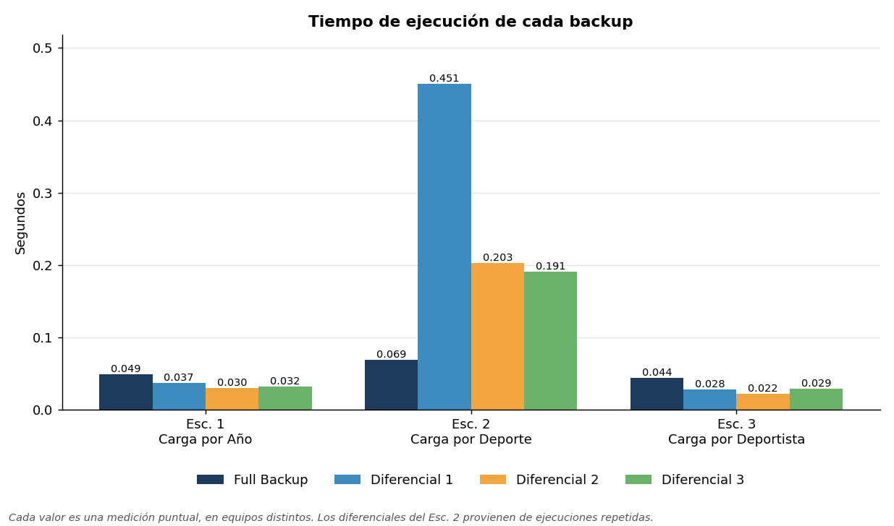

En tiempo, los resultados son menos claros. En los escenarios 1 y 3 los diferenciales tardaron entre el 50 % y el 76 % de lo que tardó su Full (por ejemplo, 0.022 a 0.029 s contra 0.044 s en el Escenario 3). En el Escenario 2, los diferenciales tardaron más que su Full (0.19 s a 0.45 s contra 0.069 s) aunque respaldan menos de la mitad de las páginas; el integrante responsable indicó que se ejecutaron varias veces y que la diferencia se atribuye a variaciones normales de rendimiento y de caché del sistema. Dado que todos los valores son de milésimas de segundo, el tiempo de respaldo no permite concluir qué estrategia es más rápida, mientras que el volumen respaldado sí muestra una diferencia clara.

### **14.4 Análisis de la restauración**

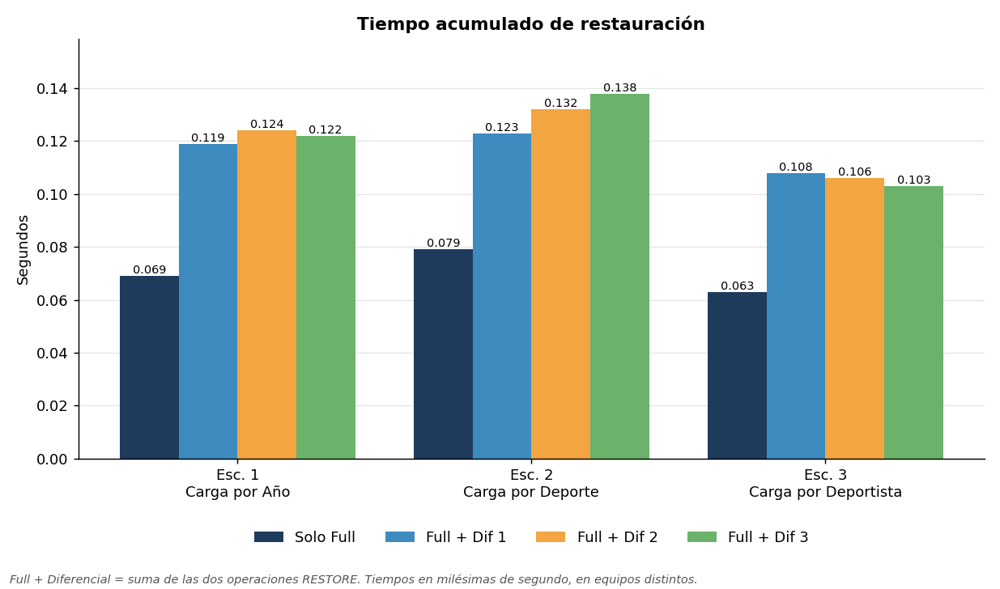

Restaurar Full + Diferencial tomó entre 0.103 s y 0.138 s, es decir, entre **1.56 y 1.80 veces** lo que toma restaurar solo el Full (0.063 s a 0.079 s). La diferencia absoluta es similar en los tres escenarios, entre 0.040 s y 0.059 s, y corresponde al costo de la segunda operación `RESTORE`. El tiempo de restaurar únicamente el diferencial fue casi constante: 0.055 s en el Escenario 1, entre 0.041 s y 0.050 s en el 2 y entre 0.041 s y 0.044 s en el 3, aunque sus páginas van de 282 a 3,378. A este volumen, el costo de restaurar un diferencial está dominado por el costo fijo de la operación y no por su tamaño.

Los tres escenarios terminaron con las **386,195 filas** de la base original tras restaurar Full + Diferencial 3, y en cada restauración se validó la integridad comparando los conteos de filas con el estado esperado (por ejemplo, PARTICIPACION), sin pérdida de datos. Debe tenerse en cuenta que restaurar solo el Full devuelve la base al momento de ese respaldo, mientras que Full + Diferencial la devuelve a un punto posterior; la comparación de tiempos es válida, pero los dos casos no recuperan el mismo estado.

### **14.5 Efecto de la fragmentación y del volumen modificado**

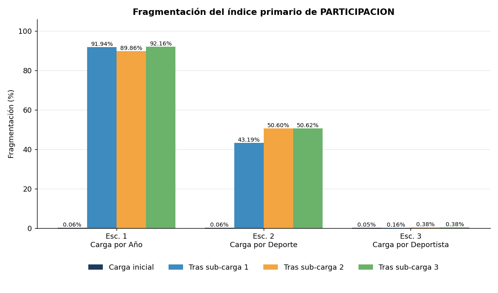

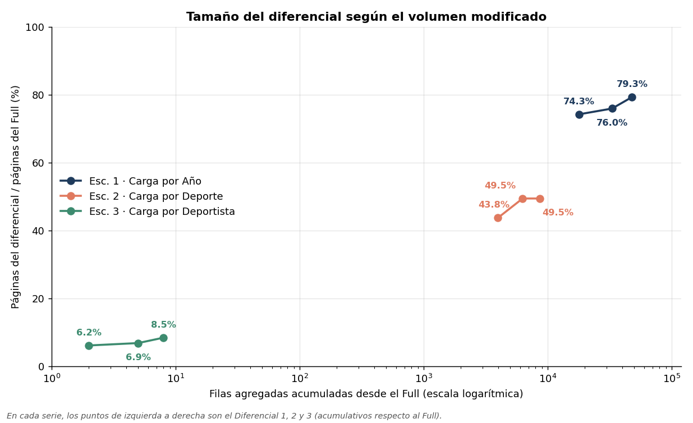

La fragmentación del índice primario de PARTICIPACION sube de 0.05 %–0.06 % tras la carga inicial a cerca de 90 % en el Escenario 1, entre 43 % y 51 % en el Escenario 2 y apenas 0.16 %–0.38 % en el Escenario 3. No se investigó la causa; una explicación posible, no verificada en este proyecto, es que las filas agregadas se insertan entre filas ya existentes y provocan divisiones de página (_page splits_). Lo que sí se observa es que, a mayor volumen modificado y mayor fragmentación, mayor es el tamaño del diferencial. El Gráfico 5 muestra la relación: el diferencial crece con el volumen modificado, pero sin pasar del 100 % de las páginas del Full, y en el Escenario 1 ya se acerca al 80 %.

### **14.6 Espacio en disco**

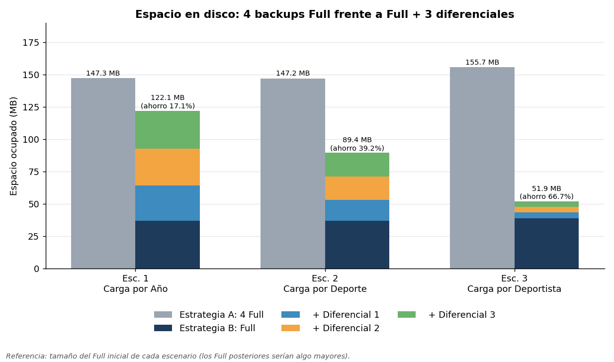

Usar un Full inicial más tres diferenciales ocupó menos espacio que sacar cuatro Full en los tres escenarios, pero el ahorro depende de cuánto cambia la base: **17.1 %** en el Escenario 1 (cargas masivas), **39.2 %** en el Escenario 2 y **66.7 %** en el Escenario 3 (cargas mínimas). Hay una particularidad: en el Escenario 3 los tres archivos diferenciales pesan exactamente lo mismo (4.32 MB, el 11.1 % del Full) aunque sus páginas crecen de 282 a 386, así que a esa escala el número de páginas describe mejor el tamaño real del diferencial que el tamaño del archivo.

### **14.7 Limitaciones**

- Cada escenario se midió en un equipo distinto, con instancias distintas de SQL Server, y con una sola ejecución por operación (salvo los diferenciales del Escenario 2, que se repitieron). Las diferencias de tiempo son de milésimas de segundo.
- La base de datos es pequeña (unos 386,000 registros y entre 35 y 39 MB por respaldo Full). Extrapolar estos resultados a bases mucho más grandes debe hacerse con cautela.
- El Escenario 3 es un caso límite (apenas 2 o 3 filas por sub-carga) y el Escenario 1 es el opuesto (cargas masivas); el Escenario 2 representa el caso intermedio.
- No se midió la Estrategia A (cuatro Full) de forma directa; su espacio y su tiempo de restauración se estiman a partir del Full de cada escenario.

### **14.8 Conclusiones y recomendación**

1. **Ambas estrategias recuperaron el 100 % de los datos** en todas las restauraciones de los tres escenarios.
2. **El diferencial ahorra espacio y volumen de respaldo cuando lo que cambia entre respaldos es pequeño o moderado** respecto a la base: 66.7 % de ahorro en el Escenario 3 (diferenciales del 6 % al 9 % de las páginas del Full) y 39.2 % en el Escenario 2 (44 % a 50 %). Cuando los cambios son masivos (Escenario 1), el diferencial alcanza el 74 % a 80 % del Full y el ahorro se reduce al 17.1 %.
3. **Restaurar con diferencial cuesta algo más**: entre 1.56 y 1.80 veces el tiempo de restaurar solo el Full, unos 0.04 a 0.06 segundos adicionales, porque se ejecutan dos operaciones. A este volumen la penalización es pequeña en valores absolutos, y a cambio se recupera un estado más reciente sin haber sacado un Full nuevo.
4. **El tiempo de respaldo no fue un criterio concluyente**: en los escenarios 1 y 3 el diferencial tardó menos que el Full, pero en el Escenario 2 ocurrió lo contrario por variaciones de ejecución; con tiempos de milésimas de segundo y equipos distintos, el volumen respaldado y el espacio en disco son mejores indicadores.
5. **Recomendación:** para esta base y este patrón de cargas, se recomienda la **estrategia de Full inicial + respaldos diferenciales** cuando los cambios entre respaldos sean pequeños o moderados (como en los escenarios 2 y 3), porque reduce el espacio y el volumen respaldado a cambio de una restauración ligeramente más lenta. Cuando un intervalo modifica gran parte de la base (como en el Escenario 1, donde el diferencial ya pesa tres cuartas partes del Full), conviene sacar un **nuevo Full**, porque el ahorro es marginal y el Full reinicia la cadena y simplifica la restauración a un solo archivo. Como criterio práctico derivado de estos resultados, puede programarse un nuevo Full cuando el diferencial supere aproximadamente la mitad del tamaño del Full.
6. **Esquema operativo sugerido** (buena práctica general, no medida en este proyecto): un Full periódico (por ejemplo semanal) con diferenciales entre ellos.
7. **Mejoras para trabajos futuros:** repetir cada medición varias veces y usar la mediana, ejecutar los tres escenarios en el mismo equipo, probar con una base de mayor tamaño y evaluar la compresión de los respaldos (alcance opcional del enunciado).